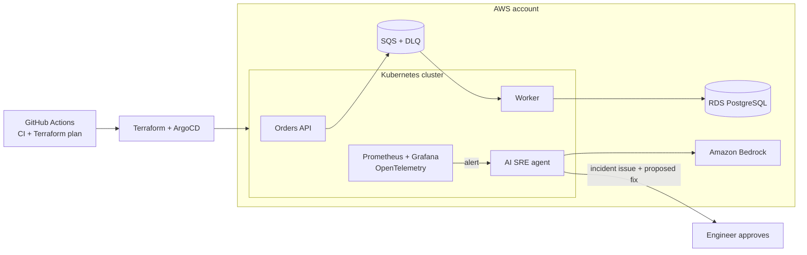

# AWS SRE AI Platform

> An order-processing platform on AWS, built end to end as code, with SLO-based observability and an **AI SRE agent** that investigates incidents and proposes fixes that only ship after human approval.


## Architecture



## Roadmap

Each phase ships as its own pull request. Phase 1 runs on AWS; phases 2–4 are code-complete and pass CI, with the end-to-end run on AWS happening in the test session.

- [x] **1. Foundation**: remote state, budget alerts, VPC, Kubernetes cluster, ECR, GitHub Actions with OIDC (no static keys)
- [x] **2. Application**: orders API and worker in containers, SQS with Dead Letter Queue and alarm, PostgreSQL, images built by CI and pushed to ECR via OIDC
- [x] **3. Observability and SLOs**: Prometheus, Grafana, SLOs with error budgets and multi-window burn-rate alerts ([docs/slo.md](docs/slo.md))
- [x] **4. AI SRE agent**: on alert, collects pods, events, logs, SLIs and queue depth with read-only access, asks Amazon Bedrock (Nova Micro) for a root-cause hypothesis and opens a GitHub issue with a proposed fix; nothing is applied without approval ([docs/sre-agent.md](docs/sre-agent.md))
- [ ] **5. Chaos and post-mortem**: five failure experiments with measured time to detect and recover ([docs/chaos.md](docs/chaos.md)), blameless post-mortem ([template](docs/postmortems/TEMPLATE.md)) and the total cost *(experiments ready; results pending the end-to-end test session)*

## Repository structure

```text
terraform/
  bootstrap/     # run once: remote-state bucket + budget alerts (local state)
  foundation/    # VPC (2 AZs, no NAT), ECR repositories, GitHub Actions OIDC role
  messaging/     # SQS orders queue + Dead Letter Queue, CloudWatch alarm -> SNS e-mail
  cluster/       # single-node k3s on EC2, SSM access only (no SSH)
apps/
  orders-api/    # FastAPI: stores the order, publishes it to SQS, /metrics
  worker/        # consumes SQS, idempotent processing, retries -> DLQ
  sre-agent/     # Alertmanager webhook -> evidence -> Bedrock -> GitHub issue
k8s/app/         # PostgreSQL, API, worker, ingress (kustomize)
k8s/observability/ # kube-prometheus-stack values, PodMonitors, SLO rules, Grafana dashboard
k8s/sre-agent/   # agent deployment with read-only RBAC on the orders namespace
scripts/
  deploy-app.sh  # runs on the node: secrets, config, ECR images, rollout
  deploy-observability.sh # Prometheus, Grafana, SLO rules and dashboard
  generate-traffic.sh     # steady order traffic for the dashboards
  deploy-agent.sh         # AI SRE agent + Alertmanager webhook
  chaos.sh                # inject a failure, measure time to detect and to recover
docs/
  adr/           # architecture decision records
.github/workflows/
```

## Cost guardrails

The project runs on limited AWS credits, so cost is a first-class requirement:

- AWS Budgets alerts at 50%, 80% and 100% of a monthly limit, tracking usage before credits.
- Every working session ends with `terraform destroy`; only the state bucket persists.
- Design choices that avoid idle cost (see [ADR 0001](docs/adr/0001-kubernetes-runtime.md)).

## Getting started

### 1. Bootstrap (once)

```bash
cd terraform/bootstrap
cp terraform.tfvars.example terraform.tfvars   # set your alert e-mail
terraform init
terraform apply
```

Confirm the subscription e-mail AWS Budgets sends you.

### 2. Foundation

```bash
cd terraform/foundation
cp backend.hcl.example backend.hcl            # use the state_bucket output from bootstrap
terraform init -backend-config=backend.hcl
terraform plan
terraform apply
```

The VPC, subnets, route tables, S3 endpoint, ECR and IAM resources have no hourly cost; they can stay up between sessions.

### 3. Messaging

```bash
cd terraform/messaging
cp backend.hcl.example backend.hcl            # same ACCOUNT_ID
cp terraform.tfvars.example terraform.tfvars  # alert e-mail
terraform init -backend-config=backend.hcl
terraform apply
```

Confirm the SNS subscription e-mail. SQS, SNS and one alarm have no hourly cost.

### 4. Cluster

```bash
cd terraform/cluster
cp backend.hcl.example backend.hcl            # same ACCOUNT_ID
cp terraform.tfvars.example terraform.tfvars  # same state bucket
terraform init -backend-config=backend.hcl
terraform apply

# open a shell on the node (no SSH) and check the cluster
aws ssm start-session --target $(terraform output -raw instance_id)
kubectl get nodes
```

The cluster is the only stack with an hourly cost: run `terraform destroy` here at the end of every session.

### 5. Application

Images are built and pushed to ECR by the **App CI** workflow on every merge to `main` (repository variable `AWS_ACCOUNT_ID` required). On the node:

```bash
git clone https://github.com/MaikonJm/aws-sre-ai-platform.git && cd aws-sre-ai-platform
./scripts/deploy-app.sh

# create an order through the ingress, then check it was processed
curl -s -X POST localhost/orders -H 'content-type: application/json' \
  -d '{"item":"t-shirt","quantity":2,"amount":"79.90"}'
curl -s localhost/orders/<id>

# an invalid order is retried 3 times and lands in the DLQ -> alarm -> e-mail
curl -s -X POST localhost/orders -H 'content-type: application/json' \
  -d '{"item":"broken","quantity":1,"amount":"-1"}'
```

### 6. Observability and SLOs

Use `instance_type = "c7i-flex.large"` (4 GB) in `terraform/cluster/terraform.tfvars` for this step. On the node:

```bash
./scripts/deploy-observability.sh     # prints the Grafana URL and how to read the password
./scripts/generate-traffic.sh 10 5    # 10 minutes at ~5 orders/s

# break the SLO on purpose and watch the burn-rate alert fire
kubectl -n orders set env deployment/orders-api FAULT_ERROR_RATE=0.2
```

### 7. AI SRE agent

Optional: a fine-grained GitHub token with **Issues: read and write** on this repository only, so the agent can open incident issues.

```bash
GITHUB_TOKEN=github_pat_... ./scripts/deploy-agent.sh
kubectl -n orders set env deployment/orders-api FAULT_ERROR_RATE=0.3   # trigger the fast-burn alert
# a few minutes later: a new issue "[Incident] OrdersApiAvailabilityFastBurn: ..."
```

### 8. Chaos experiments

```bash
./scripts/generate-traffic.sh 30 5 &        # keep traffic flowing
./scripts/chaos.sh start api-errors          # waits until the alert fires
./scripts/chaos.sh stop api-errors           # waits until it resolves
```

Scenarios and results: [docs/chaos.md](docs/chaos.md). Measurements are appended to `chaos-results.log`.

### Tear down

```bash
cd terraform/cluster && terraform destroy    # end of every session
```

## Design decisions

| Decision | Why |
| --- | --- |
| No NAT gateway | A NAT gateway bills every hour plus per GB. Nodes run in public subnets behind security groups; databases sit in private subnets with no internet route. |
| S3 gateway endpoint | S3 traffic stays on the AWS network at no cost. |
| GitHub Actions via OIDC | Short-lived credentials scoped to this repository through GitHub's immutable subject claim (`owner@id/repo@id`); no access keys stored anywhere. |
| Read-only CI role | `terraform plan` runs in CI with read access; `apply` stays a deliberate human action. |
| Immutable image tags + scan on push | A tag always means the same build, and every image is scanned for CVEs. |
| Native S3 state locking | `use_lockfile = true` replaces the DynamoDB lock table. |
| k3s on EC2 instead of EKS | Fraction of the cost, same Kubernetes API ([ADR 0001](docs/adr/0001-kubernetes-runtime.md)). |
| SQS with DLQ (3 attempts) + alarm | Failed orders are never lost; a message in the DLQ alerts by e-mail. |
| Idempotent worker | An order already processed is skipped, so SQS at-least-once delivery is safe. |
| PostgreSQL in the cluster | No RDS hourly cost; trade-offs in [ADR 0002](docs/adr/0002-database-and-pod-credentials.md). |
| AI agent recommends, humans decide | Read-only RBAC, one Bedrock model, fixed JSON output; fixes are proposed in an issue, never applied ([docs/sre-agent.md](docs/sre-agent.md)). |
| SLO-based alerting | Pages on error-budget burn rate (14.4x / 6x, two windows each), not on single errors ([docs/slo.md](docs/slo.md)). |
| Hardened pods | Non-root, read-only root filesystem, no Linux capabilities, resource limits, probes. |
| No SSH, no public Kubernetes API | Access through SSM Session Manager; only ports 80/443 are open. |
| IMDSv2 required, encrypted disk | Blocks metadata credential theft; data at rest is encrypted. |

---

**Maikon Marquez** · Cloud & DevOps Engineer · [LinkedIn](https://www.linkedin.com/in/maikon-marquez) · [GitHub](https://github.com/MaikonJm) · [Medium](https://medium.com/@maikonjm)
