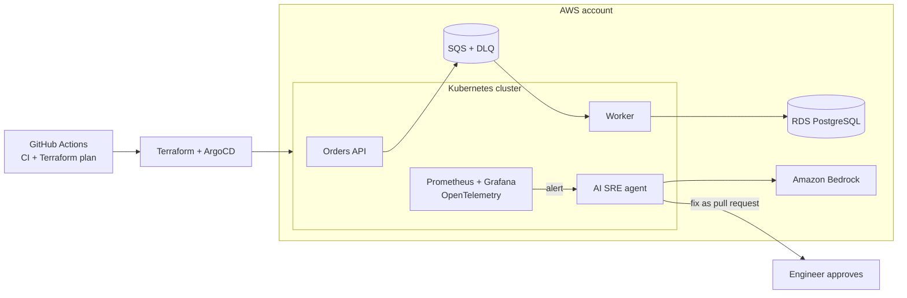

# AWS SRE AI Platform

> An order-processing platform on AWS, built end to end as code, with SLO-based observability and an **AI SRE agent** that investigates incidents and proposes fixes that only ship after human approval.


## Architecture



## Roadmap

Each phase ships as its own pull request and write-up.

- [ ] **1. Foundation**: remote state, budget alerts, VPC, Kubernetes cluster, ECR, GitHub Actions with OIDC (no static keys)
- [ ] **2. Application**: orders API and worker in containers, SQS with Dead Letter Queue, PostgreSQL, GitOps deploys with ArgoCD
- [ ] **3. Observability and SLOs**: Prometheus, Grafana, OpenTelemetry tracing, SLOs with error budgets and burn-rate alerts
- [ ] **4. AI SRE agent**: on alert, collects logs, events and metrics, asks an LLM on Amazon Bedrock for a root-cause hypothesis and opens a pull request with the fix; nothing is applied without approval
- [ ] **5. Chaos and post-mortem**: inject failures, measure detection and recovery, publish the post-mortem and the total cost

## Repository structure

```text
terraform/
  bootstrap/     # run once: remote-state bucket + budget alerts (local state)
docs/
  adr/           # architecture decision records
.github/workflows/
```

## Cost guardrails

The project runs on limited AWS credits, so cost is a first-class requirement:

- AWS Budgets alerts at 50%, 80% and 100% of a monthly limit, tracking usage before credits.
- Every working session ends with `terraform destroy`; only the state bucket persists.
- Design choices that avoid idle cost (see [ADR 0001](docs/adr/0001-kubernetes-runtime.md)).

## Getting started

### 1. Bootstrap (once)

```bash
cd terraform/bootstrap
cp terraform.tfvars.example terraform.tfvars   # set your alert e-mail
terraform init
terraform apply
```

Confirm the subscription e-mail AWS Budgets sends you.

---

**Maikon Marquez** · Cloud & DevOps Engineer · [LinkedIn](https://www.linkedin.com/in/maikon-marquez) · [GitHub](https://github.com/MaikonJm) · [Medium](https://medium.com/@maikonjm)
