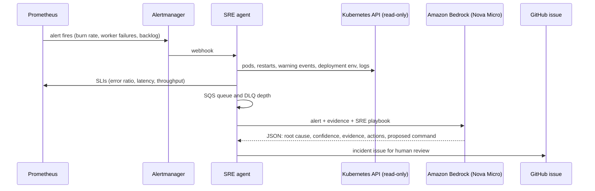

# AI SRE agent

When an SLO or application alert fires, the agent investigates it the way an on-call engineer would and writes up what it found. **It never changes anything**: a human reviews the diagnosis and decides whether to apply the proposed fix.

## Flow

## Guardrails

| Risk | Control |
| --- | --- |
| Agent changes production | Kubernetes RBAC is read-only (get/list on pods, logs, events, deployments); the proposed command is only written in the issue |
| Prompt injection through logs | Logs and events are passed as data and the system prompt tells the model to ignore instructions inside them; output must match a fixed JSON schema |
| Secrets leak to the LLM | Only literal env vars are read; values from Secrets (`secretKeyRef`) are never fetched |
| Duplicate issues and LLM cost | 15-minute cooldown per alert fingerprint; resolved alerts are ignored |
| Broad cloud permissions | The node role can invoke one model only (`bedrock:InvokeModel` on Nova Micro) |
| Unobservable agent | Exposes `sre_agent_investigations_total`, `sre_agent_llm_tokens_total` and `sre_agent_llm_latency_seconds` |

## Why a small model

Nova Micro is fast and costs a fraction of a cent per investigation. The quality comes from the evidence and the playbook, not from model size: the agent hands the model the exact signals an engineer would check first.

## Output

Each investigation becomes a GitHub issue labelled `incident` and `ai-investigation`, with the diagnosis, the evidence, recommended actions, a proposed `kubectl` command marked *requires approval*, the SLIs at investigation time and the token usage. Without a GitHub token, the same report is available at `GET /reports` and in the logs.
