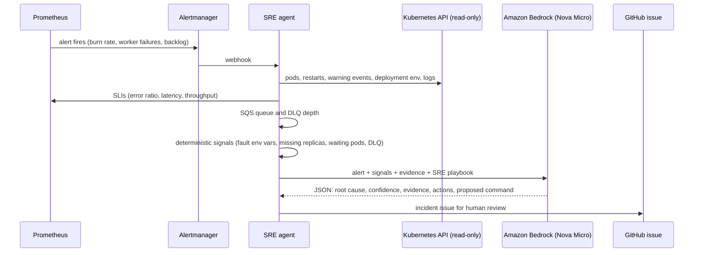

# AI SRE agent

When an SLO or application alert fires, the agent investigates it the way an on-call engineer would and writes up what it found. **It never changes anything**: a human reviews the diagnosis and decides whether to apply the proposed fix.

## Flow

## Guardrails

| Risk | Control |
| --- | --- |
| Agent changes production | Kubernetes RBAC is read-only (get/list on pods, logs, events, deployments); the proposed command is only written in the issue |
| Prompt injection through logs | Logs and events are passed as data and the system prompt tells the model to ignore instructions inside them; output must match a fixed JSON schema |
| Secrets leak to the LLM | Only literal env vars are read; values from Secrets (`secretKeyRef`) are never fetched |
| Duplicate issues and LLM cost | 15-minute cooldown per alert fingerprint; resolved alerts are ignored |
| Broad cloud permissions | The node role can invoke one model only (`bedrock:InvokeModel` on Nova Micro) |
| Unreviewable fix | The proposed command must be complete and non-interactive; `kubectl edit`, `exec -it` and `attach` are discarded in code |
| Token handling | The GitHub token is fine-grained (one repository, Issues only), stored in SSM Parameter Store and checked by `deploy-agent.sh` before use |
| Unobservable agent | Exposes `sre_agent_investigations_total`, `sre_agent_llm_tokens_total` and `sre_agent_llm_latency_seconds` |

## Deterministic signals

Before calling the model, plain code scans the evidence for the findings an engineer checks first: `FAULT_*` env vars with a non-zero value, deployments with fewer ready replicas than desired, pods waiting in `CrashLoopBackOff` or `ImagePullBackOff`, and messages in the DLQ. They go first in the prompt, and the playbook tells the model to start from them. Warning events are limited to the last 15 minutes, oldest first.

This came from the first test on AWS. With 50% of requests failing on purpose, Nova Micro blamed readiness and liveness probe failures: they were stale events from the rollout that applied the fault, and the `FAULT_ERROR_RATE` line was buried in a 20 KB JSON. With the signals in place, the same model named the right cause with high confidence ([issue #14](https://github.com/MaikonJm/aws-sre-ai-platform/issues/14)).

## Why a small model

Nova Micro is fast and costs a fraction of a cent per investigation: the first real investigation used 4,614 input and 173 output tokens and answered in 0.89 s. The quality comes from the evidence and the playbook, not from model size: the agent hands the model the exact signals an engineer would check first.

## Output

Each investigation becomes a GitHub issue labelled `incident` and `ai-investigation`, with the diagnosis, the evidence, recommended actions, a proposed `kubectl` command marked *requires approval*, the SLIs at investigation time and the token usage. Without a GitHub token, the same report is available at `GET /reports` and in the logs.
